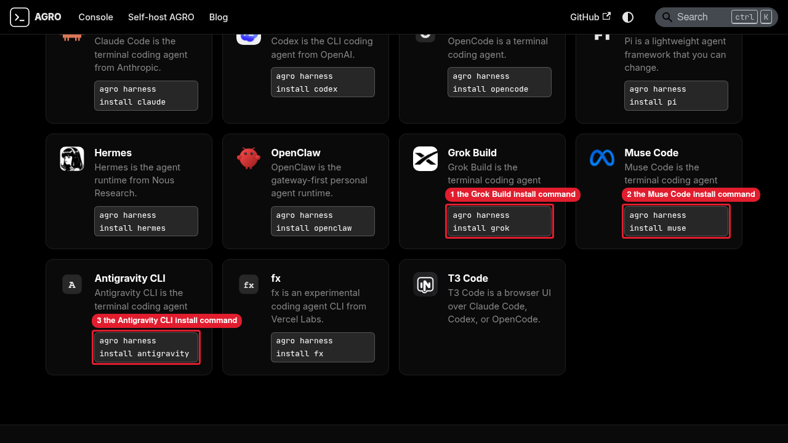

# Manual review: install commands on the landing page agent cards

The advisor ran each step in the task worktree on branch
`feat/84-landing-install-ids`, inside the sandbox `agro-sbx-local`.

1. `pnpm build` exited 0.
2. `pnpm serve --port 3285 --no-open` ran in the tmux session `web85-serve`.
3. agent-browser opened `http://127.0.0.1:3285/` at 1280x720 in the session
   `web85-evidence`. The card commands were:
   `agro harness install claude`, `codex`, `opencode`, `pi`, `hermes`,
   `openclaw`, `grok`, `muse`, `antigravity`, and `fx`. The T3 Code card shows
   no command. No card shows `claude-code`, `grok-build`, `muse-code`,
   `antigravity-cli`, or `agy`.
4. `annotate-screenshot.sh` exited 0 and wrote `agent-cards.png`:

   

   Callouts: 1 is the Grok Build install command. 2 is the Muse Code install command. 3 is the Antigravity CLI install command.

5. The advisor closed the agent-browser session and killed the tmux session
   `web85-serve`. Port 3285 then refused connections.
