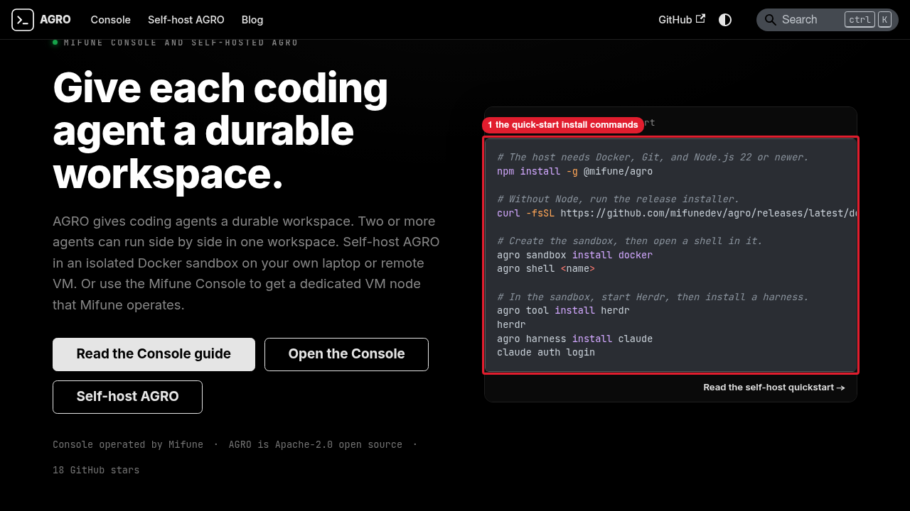

# Manual review: canonical harness names on the AGRO site

The advisor ran each step in the task worktree on branch
`feat/82-short-harness-names`, inside the sandbox `agro-sbx-local`.

1. `pnpm build` exited 0. The prebuild hook synced `docs/agro/` from the latest
   AGRO release tag.
2. `pnpm serve --port 3283 --no-open` ran in the tmux session `web83-serve`.
   `curl http://127.0.0.1:3283/` returned HTTP 200.
3. agent-browser opened `http://127.0.0.1:3283/` at 1280x720 in the session
   `web83-evidence`. The page assertion returned
   `{"claude":true,"oldId":false}`. The quick-start block holds
   `agro harness install claude`, and the page holds no
   `harness install claude-code`.
4. `annotate-screenshot.sh` exited 0 and wrote `landing-quickstart.png`:

   

   Callouts: 1 is the quick-start install commands.

5. The advisor closed the agent-browser session and killed the tmux session
   `web83-serve`. Port 3283 then refused connections.
